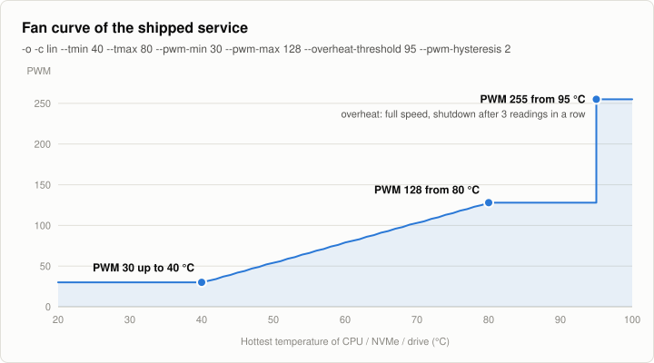

# ODROID H4 Fan Control

A Python script that controls the fan on an **ODROID H4**. It reads CPU, drive, and NVMe
temperatures, maps the hottest reading through a configurable fan curve, and writes the
result to the fan controller's PWM sysfs node — with fail-safe behavior, optional
overheat shutdown, and bounded journal logging.

---

## Features

- Controls fan speed from **CPU**, **Drive** (best-effort, needs `smartctl`), and **NVMe**
  temperatures — always uses the **hottest** available reading.
- Three fan curves: **linear**, **logarithmic**, **exponential** (`-c lin|log|exp`).
- **Fail-safe:** if *all* sensors are unavailable, the fan runs at **full speed**
  (PWM 255, regardless of `--pwm-max`) — never off — and one `ERROR` is logged on
  entering that state.
- **Manual mode:** the script sets `pwmN_enable = 1` when the node exists, so PWM
  writes actually take effect instead of being ignored by automatic/thermal control;
  it is re-checked every 30 s (e.g. after resume from suspend).
- **Safe exit:** on `systemctl stop` / `Ctrl+C` the fan is handed back to the chip's
  automatic mode (the `pwmN_enable` value found at startup) or, if the channel was
  already manual, set to **full speed** — never left frozen at the last value.
- **Overheat protection** (opt-in via `-o`): shuts down at `--overheat-threshold`
  (default **95 °C**, exact comparison, no hidden margin) once it has been reached on
  `--overheat-confirm` consecutive readings (default **3**), so a single glitched
  sensor value cannot power the board off. The fan goes to **full speed** (PWM 255,
  regardless of `--pwm-max`) from the first over-threshold reading on. If the shutdown
  command fails, the script **keeps running** (fan at full speed) and retries every
  cycle.
- **Plausibility filter:** readings outside **−40…150 °C** (uninitialised sensors,
  packed SMART raw values) are discarded with a rate-limited `WARNING`.
- **Hysteresis:** PWM is only rewritten when the target differs from the value last
  *written* by more than `--pwm-hysteresis` (default **2**), reducing sysfs churn
  without ever losing a slow temperature drift.
- **Bounded logging:** a status line on every PWM/fail-safe state change, plus a
  **30-second heartbeat** while quiet — no per-iteration log spam.
- **Robust sensor probing:** absent or hung sources/devices are cached for **60 s** and
  re-probed afterwards (a dead NVMe or SATA drive can't stall the loop forever).
- **Light drive polling:** `smartctl` / `nvme` results are reused for **30 s** instead
  of spawning a process per device every cycle; sleeping disks are not woken up.
- Auto-detects the PWM sysfs node (prefers `it8613`/`it87`); keeps probing if it is
  not there yet (driver loaded later) and re-resolves if it vanishes.
- **Import-safe & testable:** no side effects at import time; **166** pytest cases, all
  hardware I/O mocked; CI runs on every push.

---

## Requirements

- **ODROID H4** (tested: IT8613E fan controller, Debian 13, kernel 6.12).
- BIOS option **Smart Fan Mode** set to **Software** — see step 1.
- The out-of-tree **it87** kernel driver, installed via DKMS — see step 3.
- **Python 3.8+** (`python3`), **systemd**, and **root** (the service runs as root;
  manual runs need `sudo`).
- Optional **nvme-cli** for NVMe temperatures and **smartmontools** (`smartctl`) for
  SATA drive temperatures. Both are installed in step 2.

---

## Installation

Verified end to end on an ODROID H4 with Debian 13. Every block can be pasted as is.

### Step 1 — BIOS: switch fan control to software mode

Reboot into the BIOS and set

**Advanced → Hardware Monitor → Smart Fan Function → Fan Setting → Smart Fan Mode**
to **Software**,

then save and boot back into Linux.

This is not optional: as long as the BIOS controls the fan, the `it87` driver still
finds the chip (`it87: Found IT8613E chip` in `dmesg`) but creates **no** hwmon device,
so there is no PWM node to write to.

### Step 2 — Install packages

```bash
sudo apt update
sudo apt install -y git dkms build-essential linux-headers-amd64 linux-headers-$(uname -r) nvme-cli smartmontools
```

`linux-headers-amd64` keeps the kernel headers in step with kernel updates. Without it
DKMS cannot rebuild the driver for a new kernel and the PWM node disappears after the
next kernel update.

### Step 3 — Install the it87 driver

```bash
sudo git clone https://github.com/frankcrawford/it87.git /usr/local/src/it87
cd /usr/local/src/it87 && sudo ./dkms-install.sh
echo it87 | sudo tee /etc/modules-load.d/it87.conf
```

`dkms-install.sh` builds the module, installs it and loads it right away; DKMS rebuilds
it automatically on kernel updates. The last line loads it on every boot.

> With **Secure Boot** enabled the DKMS-signed module is rejected until you enroll the
> DKMS key (`sudo mokutil --import /var/lib/dkms/mok.pub`, then reboot and confirm).
> This setup was tested with Secure Boot disabled.

Check that the fan controller is there:

```bash
grep -H . /sys/class/hwmon/hwmon*/name; ls /sys/class/hwmon/hwmon*/pwm[0-9]
```

Expected (the `hwmonN` number varies between boots — the script finds it itself):

```text
/sys/class/hwmon/hwmon2/name:it8613
/sys/class/hwmon/hwmon2/pwm2
```

`No such file or directory` for the `pwm` part means the BIOS is still in automatic
mode (step 1). On the H4 the fan header is `pwm2`; the IT8613E has no `pwm1`.

### Step 4 — Get the script

```bash
sudo git clone https://github.com/reserve85/odroid-h4-fan-control.git /opt/odroid-fan
```

> Prefer a different location? Clone anywhere you like and adjust `WorkingDirectory=`
> and `ExecStart=` in the unit file from step 6 to match.

### Step 5 — Test run (before installing the service)

Run the script with exactly the flags the service uses, **including `-o`**: the
overheat shutdown is only active with `-o`, so a test without it cannot reveal a sensor
reading that would power the board off.

```bash
sudo python3 /opt/odroid-fan/fan_control.py -v -o -c lin --tmin 40 --tmax 80 --pwm-min 30 --pwm-max 128 --overheat-threshold 95 --pwm-hysteresis 2
```

A healthy run on the H4 looks like this:

```text
Using PWM sysfs path: /sys/class/hwmon/hwmon2/pwm2
fan_control.py started (sleep=2s, curve=lin, overheat=True, overheat_threshold=95, ...)
Wrote PWM 39 to /sys/class/hwmon/hwmon2/pwm2
CPU: 44°C  Drive: N/A  NVMe: 34°C  PWM: 39
Wrote PWM 30 to /sys/class/hwmon/hwmon2/pwm2
CPU: 33°C  Drive: N/A  NVMe: 34°C  PWM: 30
```

What to check:

| Line | Meaning |
|---|---|
| `Using PWM sysfs path: ...` | The fan controller node was found. |
| `No PWM sysfs path found yet` | No PWM node — go back to steps 1 and 3. |
| `CPU: ... NVMe: ... PWM: ...` | A status line. The temperatures must be plausible; PWM rises when the CPU heats up. |
| `Ignoring implausible temperature ...` | A sensor returns garbage; it is ignored. Note which one. |
| `Overheat reading 1/3 ...` | A reading hit the threshold — **do not install the service** until you know why. |

Press `Ctrl+C` to stop. The script then prints

```text
fan_control.py interrupted (Ctrl+C / SIGTERM); stopping
Set /sys/class/hwmon/hwmon2/pwm2 = 255 (full speed) on exit
```

and the fan runs at full speed until the service takes over in the next step. That is
intended: a stopped controller must never leave the fan at a low speed.

### Step 6 — Install and start the service

The unit file ships with the repository ([fancontrol.service](fancontrol.service)):

```bash
sudo cp /opt/odroid-fan/fancontrol.service /etc/systemd/system/
sudo systemctl daemon-reload
sudo systemctl enable --now fancontrol.service
```

To change the fan curve, edit the `ExecStart=` line in
`/etc/systemd/system/fancontrol.service` (see [Command Line Options](#command-line-options)),
then run `sudo systemctl daemon-reload && sudo systemctl restart fancontrol.service`.
Remove `-v` there if you do not want a `Wrote PWM ...` line for every change.

### Step 7 — Verify

```bash
systemctl status fancontrol.service --no-pager | head -5
sudo journalctl -u fancontrol.service -b --no-pager | tail -5
grep -H . /sys/class/hwmon/hwmon*/pwm2 /sys/class/hwmon/hwmon*/fan2_input
```

The service must be `active (running)` and `enabled`, the journal must show status
lines without warnings, and the last command shows the current PWM value and fan speed.

Put some load on the CPU and watch the fan follow (no extra packages needed):

```bash
for i in 1 2 3 4; do timeout 30 sh -c 'while :; do :; done' & done
watch -n2 'grep -H . /sys/class/hwmon/hwmon*/pwm2 /sys/class/hwmon/hwmon*/fan2_input'
```

Reference values from the test board with the flags above:

| State | CPU | PWM | Fan |
|---|---|---|---|
| Idle | 35 °C | 30 | ~550 rpm |
| 4 threads loaded | 54–57 °C | 64–71 | 1100–1230 rpm |
| Service stopped | — | 255 | ~3200 rpm |

Finally reboot once (`sudo reboot`) and repeat the three commands at the top of this
step: the service must come up by itself.

### Updating

```bash
sudo git -C /opt/odroid-fan pull
sudo systemctl restart fancontrol.service
```

If `git pull` lists `fancontrol.service` among the changed files, copy it again before
the restart
(`sudo cp /opt/odroid-fan/fancontrol.service /etc/systemd/system/ && sudo systemctl daemon-reload`).
This overwrites your own `ExecStart=` changes.

### Uninstalling

```bash
sudo systemctl disable --now fancontrol.service
sudo rm /etc/systemd/system/fancontrol.service
sudo systemctl daemon-reload
sudo rm -rf /opt/odroid-fan
```

The fan then runs at full speed until the next reboot; switch the BIOS back to
automatic fan control if you no longer want software control. To remove the driver as
well:

```bash
sudo rm /etc/modules-load.d/it87.conf
cd /usr/local/src/it87 && sudo ./dkms-remove.sh
```

---

## Fan curve

The shipped [fancontrol.service](fancontrol.service) uses a linear curve between 40 °C
and 80 °C, driven by the hottest of the CPU, NVMe and drive temperatures:

<picture>
  <source media="(prefers-color-scheme: dark)" srcset="docs/fan-curve-dark.svg">
  
</picture>

| Hottest temperature | PWM | Note |
|---|---|---|
| up to 40 °C | 30 | `--pwm-min` (about 550 rpm on the test board) |
| 50 °C | 54 | |
| 60 °C | 79 | |
| 70 °C | 103 | |
| 80 °C to 94 °C | 128 | `--pwm-max` |
| 95 °C and above | 255 | overheat (`-o`): full speed, shutdown after 3 readings in a row |

PWM 255 is also used when no sensor delivers a reading (fail-safe) and after the
service stops. Run without any flags, the script itself defaults to a linear curve from
PWM 20 at 30 °C to PWM 255 at 80 °C, without overheat shutdown.

The picture is generated from the unit file and the real curve code; after changing
the flags in `fancontrol.service`, refresh it with `python3 docs/make_fan_curve.py`.

---

## Command Line Options

| Option | Description |
|---|---|
| `-v`, `--verbose` | Enable verbose (DEBUG) logging. |
| `-t`, `--sleep <seconds>` | Sleep interval between checks (default **2**, must be > 0). |
| `-o`, `--overheat` | Enable overheat protection (shutdown when threshold reached). |
| `--overheat-threshold <°C>` | Shutdown threshold (default **95**). Triggers **exactly** at this temperature; must be ≥ 0. |
| `--overheat-confirm <n>` | Consecutive over-threshold readings required before shutdown (default **3**, must be ≥ 1). |
| `--pwm-hysteresis <value>` | Only rewrite PWM when it changes by more than this (default **2**, must be ≥ 0). |
| `-c`, `--curve <lin\|log\|exp>` | Fan curve type (default `lin`). |
| `--pwm-min <value>` | Minimum PWM value (default `20`, range `0..255`). |
| `--pwm-max <value>` | Maximum PWM value of the normal curve (default `255`, range `0..255`). Emergencies (fail-safe, overheat with `-o`, loop error) use PWM 255 regardless. |
| `--tmin <°C>` / `--tmax <°C>` | Temperature range for the curve (default `30`/`80`, `tmin` must be < `tmax`). |

Invalid values (e.g. `--tmin >= --tmax`, `--sleep <= 0`, PWM outside `0..255`,
negative hysteresis or threshold) are rejected with a clean error and **exit code 2**.

---

## Examples

Manual run with custom settings:

```bash
sudo /usr/bin/python3 /opt/odroid-fan/fan_control.py -v -o -c lin --tmin 40 --tmax 80 --pwm-min 30 --pwm-max 128 --overheat-threshold 95
```

Service management and logs:

```bash
sudo systemctl start fancontrol.service
sudo systemctl stop fancontrol.service
sudo journalctl -u fancontrol.service -f -o short-iso-precise
```

## Behavior Notes

- **Temperature sources** (in order): coretemp/hwmon labels `package`/`core` → thermal
  zones (hottest wins) → `sensors` output. NVMe uses `nvme smart-log` with an hwmon
  fallback; drives use `smartctl -A` (best-effort, reported as `N/A` if unavailable).
- **Aggregation:** the hottest reading across CPU/Drive/NVMe drives the curve. If *all*
  sensors are unavailable the script fails safe to **full speed** (PWM 255).
- **Emergency speed:** `--pwm-max` only limits the normal curve. In fail-safe, at or
  above `--overheat-threshold` with `-o` set, and after an unhandled loop error the
  fan is driven at PWM **255**. Without `-o` the threshold is ignored and the curve
  maximum applies. The fan returns to the curve as soon as the condition clears.
- **PWM write only on change:** the value is rewritten only when the target differs
  from the value last written by more than `--pwm-hysteresis`; inside that band the
  applied value is held (and that is what the status line shows). The curve end
  points `--pwm-min` / `--pwm-max` are always written exactly. Failed writes are
  retried on the next cycle (the cache only advances on success).
- **Manual mode:** the script writes `1` to `<pwm-path>_enable` if that file exists and
  isn't already `1`, logging the change — automatic/thermal firmware control would
  otherwise silently ignore PWM writes. Checked at startup, whenever a new PWM node is
  adopted, and on every 30 s heartbeat.
- **Exit:** when the script stops (`SIGTERM` from `systemctl stop`, `Ctrl+C`), it
  restores the `pwmN_enable` value it found at startup. If that was already `1`
  (manual), or after an overheat shutdown, it writes PWM **255** instead. A
  `systemctl restart` therefore causes a short full-speed burst on such boards.
- **Drive polling:** `smartctl` and `nvme smart-log` results (including "no
  reading") are cached for **30 s**, so the fan reacts to drive/NVMe temperature
  changes with up to 30 s delay; CPU temperature and the NVMe hwmon fallback are read
  from sysfs every cycle. `smartctl -A -n standby` is used, so a sleeping disk is
  never spun up just to read its temperature (it shows as `N/A` while in standby).
- **Logging cadence:** a status line on every PWM/fail-safe state change, plus a
  heartbeat every **30 s** while nothing changes; entering fail-safe logs a single
  `ERROR`. With the default 2 s interval, journal volume stays bounded.
- **Sensor probing:** missing binaries/devices and hung probes are cached for **60 s**
  (per device), then re-probed — so a drive added after startup is picked up, and a
  hanging `smartctl`/`nvme` call can't stall every loop.
- **Overheat shutdown** only happens with `-o` set. The first attempt logs `CRITICAL`;
  if the `shutdown` command fails, the loop keeps the fan at full speed and retries,
  logging at most one `ERROR` per 30 s.
- **Loop robustness:** `sleep` is the last call of every iteration; unhandled
  exceptions are logged, the fan is set to full speed (PWM 255), and the loop backs off
  (`max(sleep, 5)` seconds); `Ctrl+C` exits cleanly.

---

## Development / Testing

The full `pytest` suite lives under `tests/` — **all hardware I/O (sysfs, subprocess)
is mocked**, so it runs anywhere (Linux, Windows, CI).

```bash
# install the package in editable mode with dev tools (pytest + ruff)
python3 -m pip install -e ".[dev]"

# run the suite (166 tests, ~0.2 s; a 30 s faulthandler guard fails hangs fast)
python3 -m pytest

# lint
ruff check fan_control.py tests/
```

Notable test guarantees:

- `tests/test_import_safety.py` — importing `fan_control` performs **no**
  argparse/sysfs work (the historical cause of endless pytest runs).
- `tests/test_logging.py` — log cadence: forced on state change, 30 s heartbeat,
  exactly one fail-safe `ERROR`.
- `tests/test_pwm_enable.py` — manual-mode setup and PWM path re-resolution.

CI (`.github/workflows/ci.yml`) runs ruff + pytest on every push and pull request
against Python 3.8, 3.11, and 3.13.

## Troubleshooting

**Board powers off / "crashes" during boot as soon as the service is enabled, but the
manual test was fine** — almost always the overheat shutdown (`-o`) firing on a bogus
sensor value at boot; a manual run without `-o` cannot trigger it. Recover by booting
into recovery/maintenance mode and running `systemctl disable fancontrol.service`,
then look at the log of the boot that went down:

```bash
# previous boot (needs a persistent journal: sudo mkdir -p /var/log/journal)
sudo journalctl -b -1 -u fancontrol.service -o short-iso-precise
# was it a clean shutdown or a real crash?
last -x | head
```

`Overheat threshold reached: shutting down (...)` names every sensor value at that
moment. The known cause on the ODROID H4: `nvme smart-log` (nvme-cli 2.x) prints the
temperature in **Fahrenheit** under US locales (`105 °F (314 K)`), and older versions
of this script read that number as °C — e.g. `temp=118` for a 48 °C drive. The unit
is now parsed explicitly. Current versions also ignore readings outside −40…150 °C and need
`--overheat-confirm` (default 3) consecutive hits, so a single glitch no longer powers
the board off. Update (`git pull`), re-run step 5 **with `-o`**, then re-enable the
service. If the log shows no fancontrol lines at all before the hang, it is a kernel
problem (usually `it87` with `force_id`): check `journalctl -b -1 -k -p err`.

**`No PWM sysfs path found` in the log** — no fan controller node was detected.
List what the system exposes:

```bash
for h in /sys/class/hwmon/hwmon*; do echo -n "$h: "; cat $h/name 2>/dev/null || echo "(no name)"; ls $h | grep -E '^pwm|^fan' 2>/dev/null || true; done
```

- No `it8613` entry and no `pwm*` at all, but `sudo dmesg | grep it87` shows
  `Found IT8613E chip` → the BIOS still controls the fan. Set **Smart Fan Mode** to **Software**
  (step 1) and reboot.
- `dmesg` shows nothing about `it87` → the driver is not loaded: install it (step 3)
  or load it with `sudo modprobe it87`.
- Worked before, but no `pwm*` after a reboot or kernel update → `modprobe it87` only
  lasts until reboot unless `/etc/modules-load.d/it87.conf` exists, and DKMS can only
  rebuild the module for a new kernel if the matching headers are installed
  (`linux-headers-amd64` from step 2 takes care of that; check with
  `sudo dkms status`). If `modprobe it87` fails with `No such device`, the in-tree
  driver could not claim the chip — install the DKMS module from step 3, or force
  detection with `sudo modprobe it87 force_id=0x<ID>` using the chip ID reported by
  `sudo sensors-detect`. The service does not need a restart afterwards: while no PWM
  node is known it probes for one every cycle and logs `Using PWM sysfs path: ...`
  once it appears.
- Entries exist but the wrong chip is picked → adjust the `preferred_names` tuple in
  `find_pwm_path()` (`fan_control.py`).

**PWM path found, writes succeed, but the fan speed never changes** — the channel is
likely still under automatic/thermal control. The script forces manual mode at startup:

```text
Set /sys/class/hwmon/hwmon2/pwm2_enable = 1 (manual mode; was 2)
```

If you instead see `Could not set ... to manual mode`, set it manually to see why
(on the H4 the fan is `pwm2`):

```bash
echo 1 | sudo tee /sys/class/hwmon/hwmon*/pwm2_enable
```

Also verify the BIOS option **Smart Fan Mode** is set to **Software** (step 1).

**CPU temperature looks too low / like chassis air** — you are probably on an ACPI
thermal zone instead of `coretemp`. Ensure the `coretemp` driver is loaded
(`cat /sys/class/hwmon/hwmon*/name`) — the script prefers it automatically.

**Drive temperatures always show `N/A`** — install `smartmontools`
(`sudo apt install smartmontools`) and make sure `smartctl` is on `PATH` and the script
runs as root (the service does). A disk in standby also reports `N/A` — it is
deliberately not woken up.

**NVMe temperatures always show `N/A`** — install `nvme-cli` (`sudo apt install nvme-cli`).
Remember missing sources are re-probed after at most **60 s**, not immediately.

**Log says `fail-safe: no readings`** — *every* sensor source is unavailable. The fan is
held at full speed (PWM 255) as a precaution. Check the individual sources (previous points) and
run with `-v` for detail.

**Overheat shutdown never happens** — the feature is opt-in: pass `-o`
(`--overheat`). Without it the threshold is ignored by design.

**`Overheat shutdown attempt ... failed`** — the `shutdown` command was not available
or returned an error. The script keeps running with the fan at full speed and retries; fix the
underlying issue (e.g. systemd/shutdown not present).

---

## Credits

Based on the ODROID wiki article *Fan Speed Control with Temperature* and the original
shell script. Ported to Python and adapted locally. YMMV.
